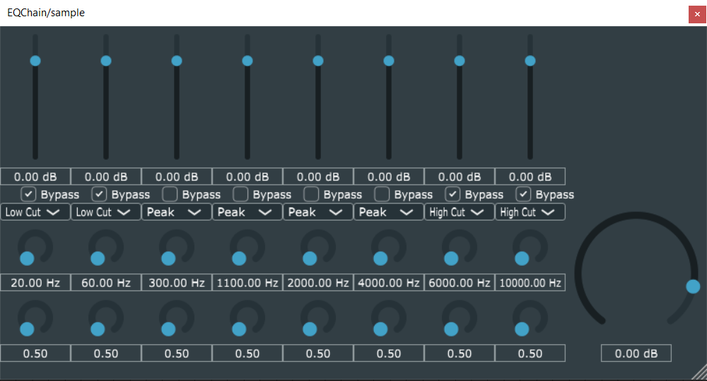

# EQChain

The plugin is a versatile tool designed to allow precise sculpting of audio frequency response during mixing or music production. This plugin is based on Ableton Live's EQ Eight and features eight bands of parametric equalization with adjustable frequency, gain, and Q settings. Throughout the creation process, I focused on understanding the phase shifting that occurs within EQs and compared my plugin's phase changes with those of multiple commercial stock and third-party EQs. Every band is a JUCE IIR (biquad) filter, so EQChain is a non-linear phase EQ. The writeup covers the tradeoffs between linear and non-linear phase designs.

**Requirements**

To use this audio plugin, you will need a Digital Audio Workstation (DAW) that supports VST, VST3, or AU plugin formats. The plugin was built and tested on Windows, but should also work on Mac and Linux systems.

**Installation**

To install the plugin, simply take the source files and replace them in your own project. Build the vst then copy the plugin file to your DAW's plugin folder. The plugin file will have a .vst3 extension depending on the format you choose. Once the plugin is installed, you can use it in your DAW like any other audio effect plugin.

**Usage**

This plugin has 8 specific frequency bands, where you can adjust the filter type, frequency, gain, and q, as well as a bypass button for that specific band. On the right, there is an output gain knob to adjust the final output volume. Some frequency bands have limited filter types due to the frequency range not needing certain filter types.

Read more in my writeup, [The Power of Precision](../docs/writeups/EQChain%20-%20The%20Power%20of%20Precision.pdf).

An updated version lives in [EQChain2](../EQChain2).
