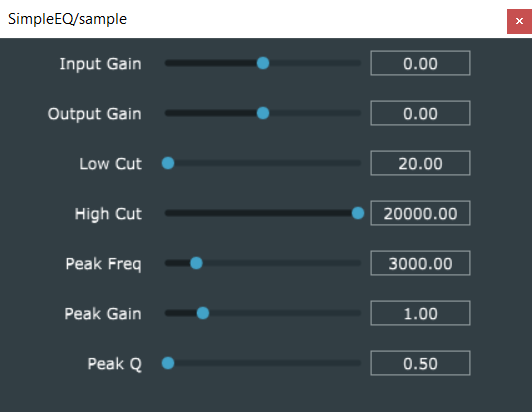
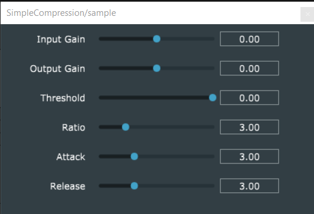
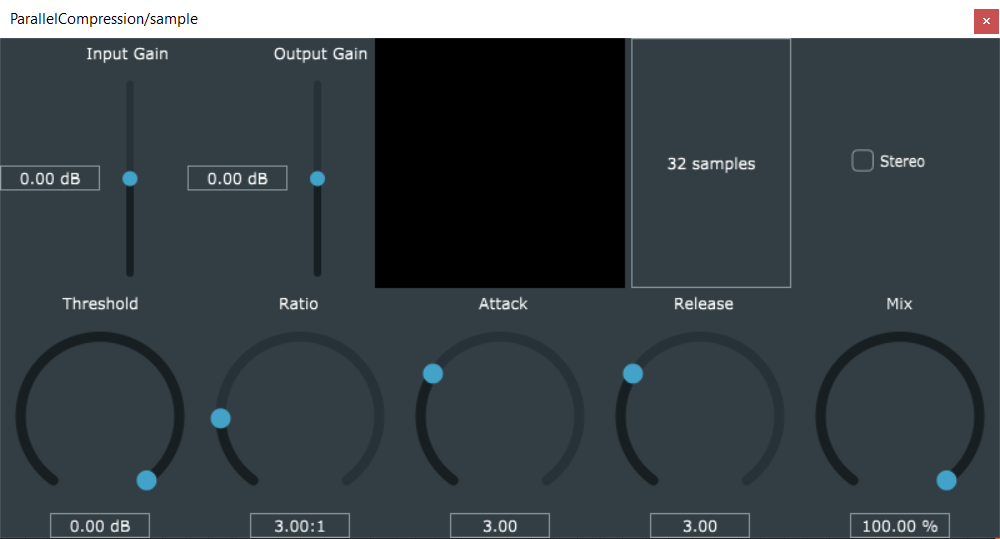
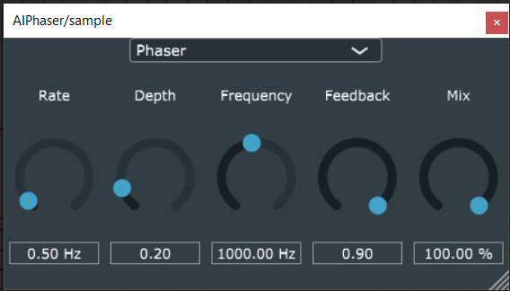
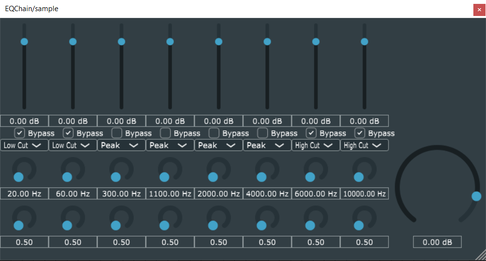

# JUCE Plugins

Audio effect plugins I built in C++ with [JUCE](https://juce.com/) during 2023 while learning DSP and plugin development. This repo collects them in one place as a record of that work. They are not maintained.

For my current audio work, see [snds](https://github.com/laceyp99/snds).

## Plugins

| Plugin | Built | What it does | Writeup |
| --- | --- | --- | --- |
| [SimpleEQ](SimpleEQ) | Feb 2023 | Low cut, high cut, and one adjustable peak filter | |
| [SimpleCompression](SimpleCompression) | Feb 2023 | Compressor with threshold, ratio, attack, release, and input/output gain | |
| [ParallelCompression](ParallelCompression) | Feb 2023 | Compressor with a dry/wet mix knob and a waveform viewer | |
| [AIChorusPhaser](AIChorusPhaser) | Mar 2023 | Switchable chorus and phaser, built with help from ChatGPT | [PDF](docs/writeups/AIChorusPhaser%20Writeup.pdf) |
| [EQChain](EQChain) | Mar 2023 | Eight band parametric EQ modeled on Ableton Live's EQ Eight | [PDF](docs/writeups/EQChain%20-%20The%20Power%20of%20Precision.pdf) |
| [AutoPanner](AutoPanner) | Apr 2023 | LFO auto-panner with sine, square, and saw shapes and tempo sync, built with help from GitHub Copilot | [PDF](docs/writeups/AutoPanner%20with%20CoPilot.pdf) |
| [EQChain2](EQChain2) | Aug 2023 | EQChain rework with 48 dB/oct cuts and an EQ Eight style single-knob GUI | |

## Screenshots

| SimpleEQ | SimpleCompression |
| --- | --- |
|  |  |

| ParallelCompression | AIChorusPhaser |
| --- | --- |
|  |  |

## Building

Each folder holds the plugin's `Source/` files. These are Projucer projects, and only some of the original `.jucer` files survived:

- **SimpleEQ** and **EQChain** include their `.jucer`. Open it in Projucer and point the module paths at your JUCE install (they expect `C:\JUCE`).
- **SimpleCompression** includes its `.jucer`, but `Source/PluginProcessor.h` was never committed, so it will not build as-is.
- **The rest** have no `.jucer`. Create a new Projucer audio plugin project and replace its `Source/` files with these.

These were built against JUCE 7 on Windows with Visual Studio 2022.

## History

Each plugin started in its own repo in 2023. Those repos were merged here in November 2026 and then deleted, so the per-plugin commit history is not preserved.

## License

[GPL-3.0](LICENSE)
